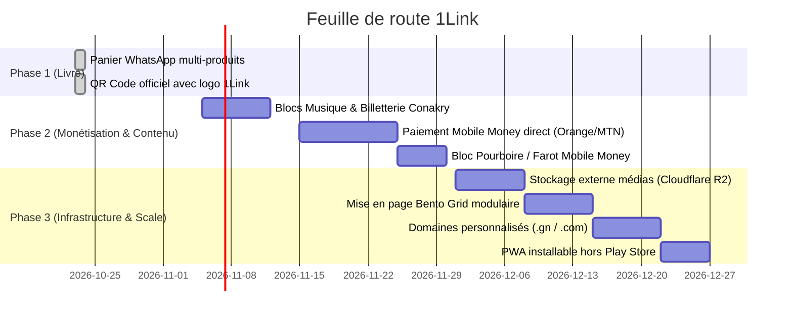

# Feuille de route et évolutions futures (1Link)

Ce document consigne les axes d'évolution stratégiques, les fonctionnalités planifiées et les recommandations issues de l'analyse du projet **1Link** pour le marché guinéen et ouest-africain.

---

## 1. Déjà implémenté dans cette itération

| Fonctionnalité | Description | Bénéfice pour le marché guinéen |
|---|---|---|
| **Panier d'achat WhatsApp multi-produits** | Dans le bloc Boutique (`ShopRender`), ajout d'un panier interactif avec sélection de quantités (`+` / `-`), barre flottante du panier (`🛒 Panier (X) · Y GNF`), et modale de finalisation avec saisie du lieu de livraison et note pour le vendeur. | Génère en un clic un bon de commande WhatsApp clair, structuré et sans ambiguïté. Préserve également la commande directe 1-clic par article. |
| **QR Codes officiels avec logo 1Link au centre** | Intégration du symbole officiel 1Link au centre de tous les QR codes (dans le composant SVG `QrCode` et dans l'export PNG `qrPngBlob`), avec niveau de tolérance d'erreurs augmenté à **30 % (`H`)**. | QR codes ultra-reconnaissables et professionnels sur les affiches A4, les cartes de visite imprimables, le dialogue de partage et le bloc QR. |

---

## 2. Nouveaux Blocs Spécifiques au Marché Guinéen (Étape C — En réserve)

Ces blocs ont été conçus lors de l'analyse et sont conservés ici avec leurs spécifications pour être implémentés lors des prochaines itérations :

### Option 1 : Bloc Audio / Musique & Podcasts
* **Contexte** : La scène musicale guinéenne (musique urbaine, pastorale, mandingue, rap, afro-pop) est très active et virale sur les réseaux.
* **Plateformes à intégrer** :
  * Lecteurs natifs ou intégrés : **Audiomack, Boomplay, SoundCloud, YouTube Music, Spotify**.
  * Spécificité locale : Audiomack et Boomplay sont particulièrement populaires en Afrique de l'Ouest pour la consommation de musique sur mobile.
* **Option « Single Promo / Téléchargement MP3 »** :
  * Permettre aux artistes de proposer un bouton de téléchargement direct d'un morceau promotionnel (fichier audio hébergé ou lien direct), indispensable pour la diffusion gratuite auprès des fans et des DJ locaux.
* **Données du bloc (`AudioData`)** :
  * `title`: titre du morceau ou du podcast
  * `artist`: nom de l'artiste ou du créateur
  * `platform`: plateforme de diffusion
  * `url`: lien d'intégration / écoute
  * `downloadUrl`: lien optionnel de téléchargement direct
  * `coverUrl`: pochette du titre ou de l'album

### Option 2 : Bloc Billetterie & Événements (Conakry Events)
* **Contexte** : Concerts géants (Esplanade du Palais du Peuple, Stade Général Lansana Conté, Chapiteau By Issa), soirées, formations professionnelles, foires commerciales et meetups.
* **Fonctionnalités clés** :
  * **Compte à rebours dynamique** jusqu'au jour et à l'heure de l'événement.
  * **Localisation avec repère guinéen** : nom du lieu, repère d'accès (« face à... »), et lien d'itinéraire.
  * **Types de billets** : Pass Standard, VIP, VVIP, Table.
  * **Réservation simplifiée** : bouton de réservation par message WhatsApp pré-formaté ou paiement direct Mobile Money.
* **Données du bloc (`EventData`)** :
  * `title`: nom de l'événement
  * `organizer`: organisateur ou promoteur
  * `date`: date et heure (ISO UTC)
  * `venue`: lieu et repère de quartier
  * `mapUrl`: lien vers la carte
  * `coverUrl`: affiche officielle de l'événement
  * `tickets`: liste des catégories de places avec libellé, prix et disponibilité
  * `bookingPhone`: numéro WhatsApp de réservation

### Option 3 : Bloc Téléchargement Numérique (Digital Products)
* Vente ou mise à disposition gratuite de fichiers : grilles tarifaires PDF, catalogues de produits, menus de restaurants, fiches de formation, e-books.
* Déclenchement d'une demande par WhatsApp ou téléchargement direct.

### Option 4 : Bloc Avis & Preuves Sociales
* Mise en avant de témoignages clients, captures d'écrans de retours WhatsApp vérifiés et notes de satisfaction pour rassurer les acheteurs en ligne.

---

## 3. Feuille de Route Technique & Monétisation

### Automatisation Mobile Money (Orange Money Guinée & MTN MoMo)
* Raccordement via un agrégateur régional (CinetPay, Bizao, PayDunya) ou API directe opérateur.
* Déclenchement de **Push USSD** (demande de confirmation PIN sur le téléphone de l'acheteur) avec validation par webhook Vercel.
* Automatisation de l'activation des abonnements Basique / Pro / Business et des ventes directes.

### Stockage Objets Médias (Cloudflare R2)
* Migration de la table PostgreSQL `media` (`bytea`) vers un bucket R2 compatible S3 sans frais de bande passante, avec compression automatique en formats modernes WebP et AVIF.
